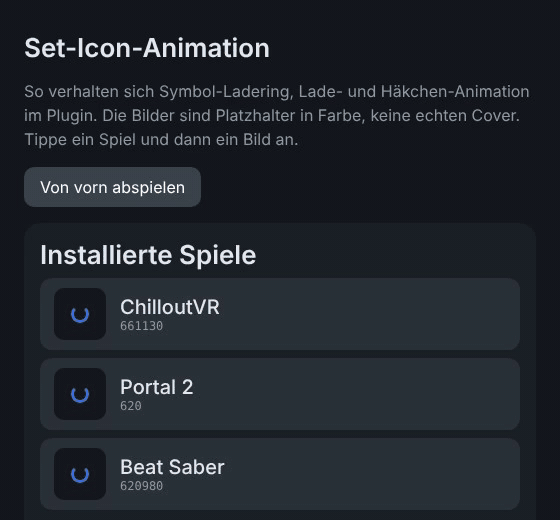

# SteamGridDB Plugin for Framey (unofficial!)


A modified version of the popular [SteamGridDB](https://www.steamgriddb.com/) plugin, specifically tailored for the **Framey Plugin Loader** on the **Steam Frame**.

This plugin allows you to seamlessly customize and swap game artwork (capsules, headers, hero images, logos, and icons) directly on your Steam Frame using the SteamGridDB database.



*Icons in the preview: images from SteamGridDB, credit goes to their authors*

## 📸 Features

* 🖼️ **Custom Artwork:** Change covers, wide covers, heroes, logos and icons directly in the user interface
* ⚡ **Instant refresh:** The new artwork shows up right away, no SteamVR restart needed in most cases
* 🎮 **Game icons in the list:** Every game shows its icon next to its name, with a loading ring until it is ready
* ✨ **Feedback animation:** A spinner while the image is set and a green check when it is done
* ❓ **Unknown apps:** Apps SteamGridDB does not know (for example non-Steam shortcuts) are listed in their own section
* 🔍 **Search by name:** For unknown apps you can enter a name and pick from similar games, your choice is remembered
* 🗂️ **Icons as .ico:** SteamGridDB icons in .ico format are converted automatically
* 🌍 **6 languages:** German, English, French, Spanish, Italian and Portuguese

## 🛠️ Installation

1. **Prerequisites:**
   * A set up **Steam Frame** with the **Framey Plugin Loader** installed and the **Framey App** on the PC.

2. **Manual Installation:**
   * Download the latest release (`.zip` or folder).
   * Copy the zip-folder path into your Framey Loader plugins directory:
     ```bash
     e.g. C:\Users\user\Downloads\steamgriddb-framey.zip   # (Adjust path based on your download location)
     ```
   * Press "add plugin" and let the Framey App automaticly install the plugin - SteamVR will automaticly restart

## ⚙️ Configuration (API Key)

To use the plugin, you need a personal API key from SteamGridDB:

1. Visit [SteamGridDB Profile Preferences](https://www.steamgriddb.com/profile/preferences).
2. Scroll down to the **API** section and generate a new key.
3. Open the plugin settings in the Framey menu on your Steam Frame.
4. Enter your API key and save the settings.

**No copy and paste between the desktop and the headset?** Put the key into a text file named `steamgriddb-key.txt` in your home folder on the Steam Frame (desktop mode). The plugin imports it automatically the next time it needs a key. Delete the file afterwards if you do not want it lying around.

## 🚀 How to Use

1. Open the SteamVR Dashboard on the Steam Frame.
2. Open the **Framey Plugin Menu**.
3. Select **SGDB** and tap the game you want to change.
4. Choose a category (Cover, Wide, Hero, Logo, Icon) and browse for your desired image.
5. Tap an image: a spinner appears, then a green check once the artwork is set.
6. If it doesn't show up right away, restart SteamVR.

**Unknown apps:** If SteamGridDB doesn't know an app, it moves to the *Unknown apps* section. Tap it, check the name in the search field and tap one of the suggested games. The match is saved, and the artwork of that game is loaded from then on. *Remove match* undoes it.

## 🤝 Credits & Acknowledgments

* Thanks to the **SteamGridDB** team for providing their excellent API and community platform
* Thanks to the original developers of the SteamGridDB plugin for Decky Loader / Steam Deck
* Thanks to the creators of the **Framey Plugin Loader**
* The images in the preview GIF are artwork from SteamGridDB, all rights remain with their authors and the respective game owners

## 📄 License
eh...
